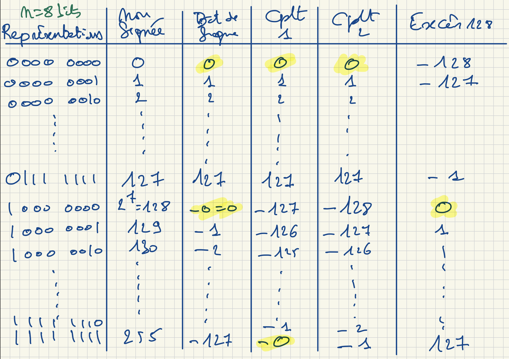

# Écriture des nombres dans différentes bases

## Compter en binaire

En binaire, on utilise seulement deux chiffres : $0$ et $1$.

On compte donc ainsi :

$$
0,\ 1,\ 10,\ 11,\ 100,\ 101,\ 110,\ 111,\ 1000,\dots
$$

Exemple :

$$
1111_2 = 15_{10}
$$

| Base 10 | Base 2 | Base 10 | Base 2 |
| ------- | ------ | ------- | ------ |
| 0       | 0      | 8       | 1000   |
| 1       | 1      | 9       | 1001   |
| 2       | 10     | 10      | 1010   |
| 3       | 11     | 11      | 1011   |
| 4       | 100    | 12      | 1100   |
| 5       | 101    | 13      | 1101   |
| 6       | 110    | 14      | 1110   |
| 7       | 111    | 15      | 1111   |

## 2.2.1 — Changements de base

### Changement de base

On compte en base 10

$$
1234,56_10
$$

En base 2, on utilise {0;1}, ça donne:

$$
1001,101_2 = 9,625_{10}
$$

On fait la somme des puissances de 2 correspondant aux bits égaux à 1 :

$$
1001,101_2 = 1\cdot2^3 +0\cdot2^2 +0\cdot2^1 +1\cdot2^0 +1\cdot2^{-1} +0\cdot2^{-2} +1\cdot2^{-3}
$$

$$
= 8 + 1 + \frac{1}{2} + \frac{1}{8} = 9,625_{10}
$$

### Base 10 → Base 2

Si nombre entier $>= 0$

On divise par 2, on regarde les restes de 1 ou de 0;

le nombre de départ divisé est le poids faible et le dernier est le poids fort.

$$
175_{10} = 10101111_2
$$

Exemple de conversion de $175_{10}$ en base 2 :

$$
\begin{array}{rcl} 175 \div 2 &=& 87 \quad \text{reste } 1\\ 87 \div 2 &=& 43 \quad \text{reste } 1\\ 43 \div 2 &=& 21 \quad \text{reste } 1\\ 21 \div 2 &=& 10 \quad \text{reste } 1\\ 10 \div 2 &=& 5 \quad \text{reste } 0\\ 5 \div 2 &=& 2 \quad \text{reste } 1\\ 2 \div 2 &=& 1 \quad \text{reste } 0\\ 1 \div 2 &=& 0 \quad \text{reste } 1 \end{array}
$$

On lit les restes de bas en haut, donc :

$$
175_{10} = 10101111_2
$$

### Nombres Décimaux — partie fractionnaire

$5,25_{10} \mapsto 101,01_2$

$0,25 = \frac14 = \frac{1}{2^2} = 2^{-2}$

$= 0\cdot2^{-1} + 1 \cdot 2^{-2}$

### Technique systématique

$EX: 0,625_{10}$

Base 2:  $0, (\frac12) (\frac14) (\frac{1}{16}) (\frac{1}{32}) \dots$

→ L'idée est de miltiplier et prendre note du chiffre devant la virgule 
dans le même esprit du reste.

## 2.2.2 — Opérations en base 2

### Multiplier / diviser par la base

1. En base 10, multiplier par cette base revient à ajouter un zéro à droite.
2. En base 2, multiplier par 2 revient à ajouter un zéro à droite.
3. En base 2, diviser par 2 revient à enlever le dernier bit ; ce bit donne le reste.

## 2.2.3 — Représentation des entiers non signés

### Combien de valeurs différentes puis-je représenter

Dans la mémoire, les infos sont stockées dans des cases
de taille fixe (par ex: 8 bits)

Prenons 8 bits: Dans chaque case je peux écrire
deux valeurs différentes (combinatoire)

> [!IMPORTANT]
> **Nombre de valeurs**
>
> Sur $n$ bits je peux écrire $2^n$ nombres différents.

## 2.2.4 — Représentation des entiers signés

$-5_{1O} = -101_2$

Fixons la taille de réprésenationns n = 8 bits

**(1). Bit de signe**

L'idée est que le bit de poids fort est interptété comme un signe.

Problème: (1). Le 0 est représentée 2 fois et on ne représente que 255 valeurs

Problème: (2). Difficultée de faire des opérations arithmétiques.

**(2). Complèment à 1**

D'un nombre binaire est obtenu en inversant tous les 0 et 1

$+5= 0000 0101$

$-5 = 1111 010$

Mêmes problèmes

**(3.) Complément  à 2**

Complément à 1 + 1; plus pratique

On peut faire des opérations arithmétiques

**(4). Excès à $k$**

On ajoute $k$ à toutes les valeurs, on représente (positif, sinon alors pas représentable)

*Figure 2 — Cours 28/09 - Gilles G.*

*Figure 3 — Cours 28/09 - Gilles G.*

## 2.2.5 — Représentation des nombres « réels »

Par exemple, $12,625_{10}$ = $1100, 101_2$

### On décide arbitrairement où trouve la virgule.

|             |              |
| ----------- | ------------ |
| 000...01100 | 101000...000 |

-Inconvénient 1: on doit donner 32 bits pour représenter 0

-Inconvénient 2: si on doit représenter $2^(16)$ on est obligé de consacre 16bits pour la partie entière et décimale, même si elles sont presque nulles

### (2.) La virgule flottante (IEEE754) $\approx$ "représentation scientifique"

L'exposant indique l'emplacement de la virgule.

$$
1100,101 = 1,100101 \cdot 2^3
$$

$$
0,0011 = 1,1 \cdot 2^{-2}
$$

On doit retenir,

- Les chiffres après la virgule

- l'exposant de la base

- signe

| Bit de signe | Exposant            | Mantisse/ signifiant                    |
| ------------ | ------------------- | --------------------------------------- |
| ±: 1bit      | l'exposant : 8 bits | les chiffres après la virgule : 23 bits |

-Pour le signe: bit de signe
-Pour l'exposant: excès 127

$$
42,625_{10} = 101010,101_2
$$

| Signe | Exposant  | Mantisse                |
| ----- | --------- | ----------------------- |
| 0     | 1000 0100 | 01010110100000000000000 |

-Signe: 0 $\mapsto (+)$ / 1 $\mapsto (-)$
-Exposant $5$ $\mapsto 5 + 127 = 132_{10} = 1000 01000_2$

---

[← Précédent](3.1%20-%20Unit%C3%A9s%20de%20quantit%C3%A9%20d%E2%80%99information.md) · [Suite →](3.3%20-%20Repr%C3%A9sentation%20des%20caract%C3%A8res.md)
