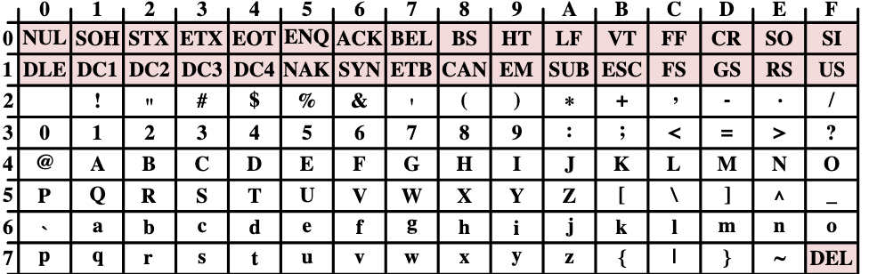

# Représentation des caractères

**ASCII**
Idée: associer une valeur entière à chaque lettre qu'on reprèsente en binaire.

*Figure 4 — Le code ASCII. Chaque caractère est représenté par une valeur hexadécimale sur 2 chiffres : le chiffre de poids fort est donné par la ligne, le chiffre de poids faible par la colonne*

**UNICODE**

---

[← Précédent](3.2%20-%20%C3%89criture%20des%20nombres%20dans%20diff%C3%A9rentes%20bases.md) · [Suite →](3.4%20-%20Repr%C3%A9sentation%20d%E2%80%99images.md)
