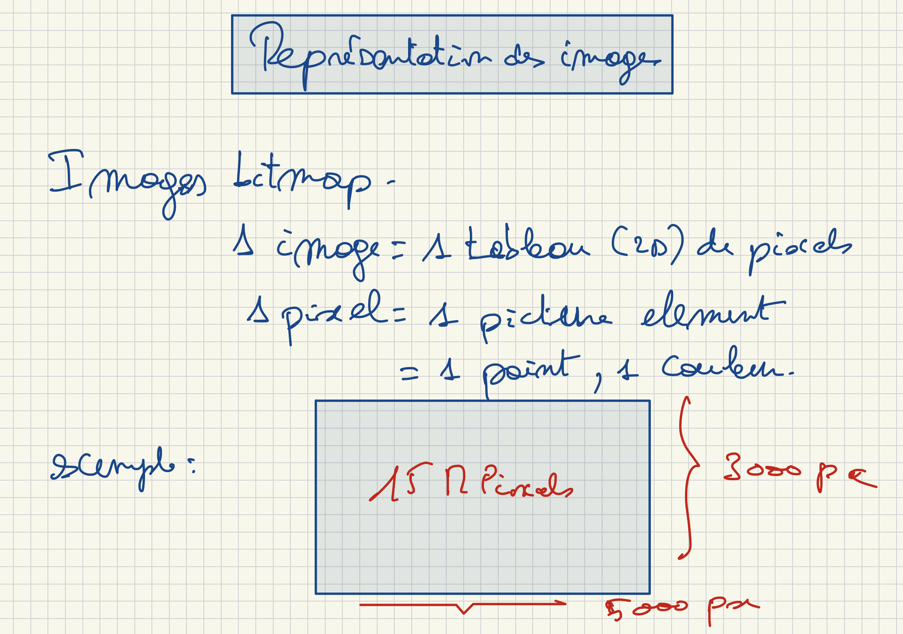

# Représentation d’images

## Images bitmap

Une image **bitmap** est un tableau à deux dimensions de **pixels** (*picture elements*).

Chaque pixel est un point de l’image auquel est associée une couleur.

## Couleur d’un pixel — RVB

Dans la représentation vue au cours, chaque pixel possède trois composantes :

| Composante | Valeurs | Taille |
| :--- | :---: | :---: |
| **Rouge — R** | 0 à 255 | 1 octet |
| **Vert — V** | 0 à 255 | 1 octet |
| **Bleu — B** | 0 à 255 | 1 octet |

Un pixel occupe donc **3 octets**, soit **24 bits**, pour ces trois composantes.

L’image peut être représentée par une séquence des valeurs de ses pixels, en conservant leurs positions dans le tableau.

*Figure 5 — Illustration du cours du 1er octobre.*

---

[← Précédent](3.3%20-%20Repr%C3%A9sentation%20des%20caract%C3%A8res.md) · [Suite →](3.5%20-%20Repr%C3%A9sentation%20des%20instructions.md)
