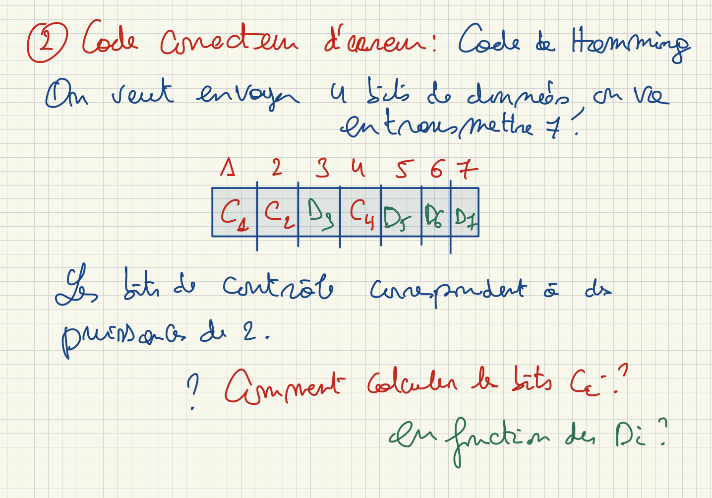

# Détection et correction d’erreurs

## Redondance

On ajoute aux données des **bits de contrôle**, calculés à partir des bits de données. Cette redondance permet de détecter certaines altérations et, selon le code, de les corriger.

## Bit de parité

### Convention de parité paire

On choisit le bit de contrôle pour que le nombre total de bits à `1`, **données et contrôle compris**, soit pair.

| Données — 7 bits | Nombre de `1` | Bit de parité | Mot transmis — 8 bits |
| :---: | :---: | :---: | :---: |
| `0101011` | 4 | **0** | `00101011` |
| `0111000` | 3 | **1** | `10111000` |

Le bit de parité est ici placé à gauche par convention. Il se calcule aussi par XOR :

$$
p = B_0 \oplus B_1 \oplus B_2 \oplus B_3 \oplus B_4 \oplus B_5 \oplus B_6
$$

### Détection et limites

À la réception, on recalcule la parité :

- Un **nombre impair de bits inversés** dans le mot transmis modifie la parité : l’erreur est détectée.
- Un **nombre pair de bits inversés** ne modifie pas la parité : ces erreurs ne sont pas détectées.
- Le contrôle inclut aussi les erreurs touchant le bit de parité lui-même.

> [!WARNING]
> **Détecter n’est pas corriger**
>
> Un bit de parité seul ne permet pas de localiser le bit erroné. Il ne corrige donc pas l’erreur. Ce mécanisme est utile lorsque les erreurs multiples sont suffisamment rares ; on peut par exemple demander une retransmission.

## Code de Hamming (7,4)

On transmet **4 bits de données avec 3 bits de contrôle**, soit 7 bits. Ici, on numérote les positions de **1 à 7 de gauche à droite**.

Les positions puissances de 2 — **1, 2 et 4** — sont réservées aux contrôles.

### Exemple : données 1011

Les données occupent D3, D5, D6 et D7 : `1`, `0`, `1`, `1`.

| C1 | C2 | D3 | C4 | D5 | D6 | D7 |
| :-----------------------------------: | :-----------------------------------: | :-----------------------------------: | :-----------------------------------: | :-----------------------------------: | :-----------------------------------: | :-----------------------------------: |
|    0     |    1     |    1     |    0     |    0     |    1     |    1     |

La couleur distingue les contrôles **C** des données **D** dans Obsidian ; les lettres restent lisibles sans couleur sur GitHub.

### Calcul des bits de contrôle

Chaque contrôle impose une parité paire sur un groupe :

| Contrôle | Positions contrôlées, contrôle compris | Calcul à partir des données |
| :--- | :--- | :--- |
| **C1** | 1, 3, 5, 7 | D3 XOR D5 XOR D7 = 1 XOR 0 XOR 1 = **0** |
| **C2** | 2, 3, 6, 7 | D3 XOR D6 XOR D7 = 1 XOR 1 XOR 1 = **1** |
| **C4** | 4, 5, 6, 7 | D5 XOR D6 XOR D7 = 0 XOR 1 XOR 1 = **0** |

Le mot transmis est donc **0110011**.

Le numéro binaire d’une position indique les contrôles concernés : par exemple, **6 = 110₂ = 4 + 2**, donc la position 6 est vérifiée par C4 et C2.

### Localiser une erreur : le syndrome

On recalcule la parité de chaque groupe complet. On note **s1**, **s2** et **s4** les résultats : `0` si le contrôle est satisfait, `1` sinon.

$$
j = s_1 + 2s_2 + 4s_4
$$

Sous l’hypothèse d’**au plus une erreur** :

- **j = 0** : aucune erreur détectée.
- **j ≠ 0** : la position **j** est erronée ; on inverse ce bit.

Exemple : si D3 est inversé, on reçoit `0100011`. Les contrôles C1 et C2 échouent, C4 est satisfait : **j = 1 + 2 = 3**. On inverse le bit 3 et on retrouve `0110011`.

> [!WARNING]
> **Hypothèse indispensable**
>
> Hamming (7,4) corrige une erreur simple. Avec plusieurs erreurs, le syndrome peut conduire à une fausse correction. La correction repose donc sur l’hypothèse d’au plus une erreur dans les 7 bits.

*Figure 6 — Illustration des contrôles, cours du 5 octobre.*

---

[← Précédent](3.5%20-%20Repr%C3%A9sentation%20des%20instructions.md) · [Suite →](3.7%20-%20S%C3%A9mantique%20d%E2%80%99une%20repr%C3%A9sentation%20binaire.md)
