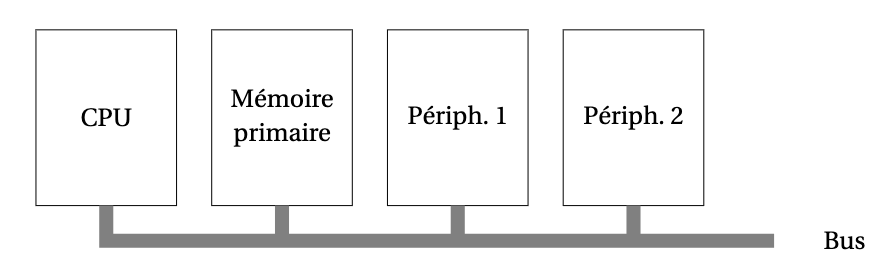

# Organisation de l’ordinateur

*Figure 7 — Un modèle simple d'organisation d'un ordinateur.*

## Plan du chapitre

- [4.1 - Mémoire primaire](4.1%20-%20M%C3%A9moire%20primaire.md)
- [4.2 - Le processeur](4.2%20-%20Le%20processeur.md)
- [4.3 - Les périphériques](4.3%20-%20Les%20p%C3%A9riph%C3%A9riques.md)

---

[← Précédent](3%20-%20Repr%C3%A9sentation%20de%20l%E2%80%99information.md) · [Suite →](4.1%20-%20M%C3%A9moire%20primaire.md)
