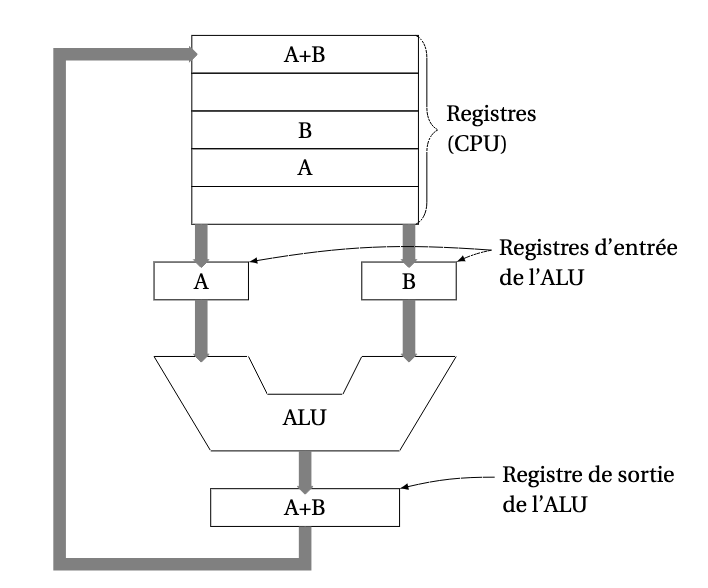
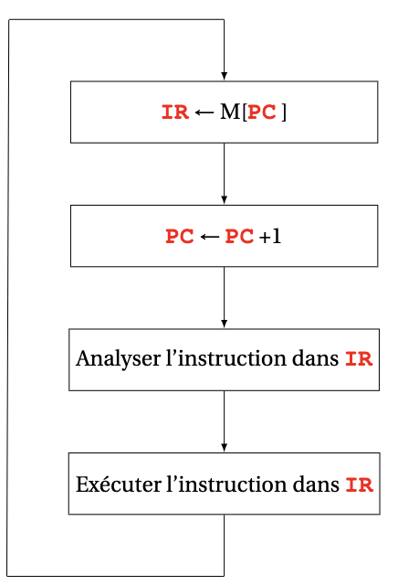
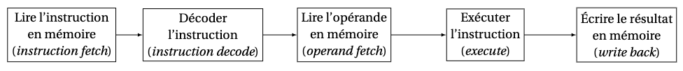
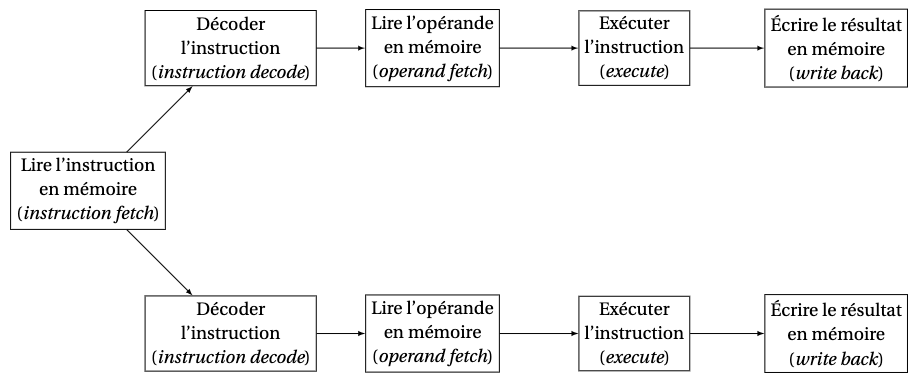

# Le processeur

## Composants du processeur

Le **CPU** exécute les programmes en **langage machine**. Il comprend notamment :

| Composant | Rôle |
| :--- | :--- |
| **Unité de contrôle** | Organise la récupération, le décodage et l’exécution des instructions |
| **ALU** | Réalise les opérations arithmétiques et logiques |
| **Registres** | Conservent des données, des adresses ou l’état du processeur |

Exemples de registres de travail sur l’i486 : `eax`, `ebx`, `ecx`, `edx`. Leurs noms et leurs tailles dépendent de l’architecture.

## Le chemin des données

Le **datapath**, ou **chemin des données**, regroupe les registres, l’ALU et les bus internes qui les relient. Les données partent des registres, sont traitées par l’ALU et les résultats retournent dans les registres.

*Figure 8 — Le chemin des données. La route grise c'est le bus.*

## Exécution des instructions

Les instructions du programme sont stockées en mémoire primaire. Deux registres de contrôle permettent de suivre leur exécution :

| Registre | Nom développé | Contenu |
| :--- | :--- | :--- |
| **PC** | *Program Counter* | Adresse de la prochaine instruction à récupérer |
| **IR** | *Instruction Register* | Instruction récupérée, en cours de décodage ou d’exécution |

### Boucle fetch–decode–execute

1. **Fetch** : lire en mémoire l’instruction située à l’adresse du PC et la charger dans l’IR.
2. Mettre à jour le PC pour préparer l’instruction suivante.
3. **Decode** : analyser l’instruction dans l’IR.
4. **Execute** : réaliser l’opération ; un saut ou un branchement peut modifier le PC.
5. Recommencer.

> [!NOTE]
> **Modèle simplifié du syllabus**
>
> Le syllabus écrit `IR ← M[PC]`, puis `PC ← PC + 1`. L’incrément réel dépend de l’unité d’adressage et de la taille de l’instruction : sur une architecture à instructions de longueur variable, il n’est pas toujours d’un octet.

*Figure 9 — Fetch-Decode-Execute; boucle d'interprétation du CPU.*

## Choix du jeu d’instructions machine

### CISC vs. RISC

Les termes désignent deux familles historiques de conception des jeux d’instructions.

| Famille | Idée générale | Exemples |
| :--- | :--- | :--- |
| **RISC** — *Reduced Instruction Set Computer* | Privilégier des instructions simples et régulières, avec de nombreux traitements sur registres ; les accès mémoire sont souvent séparés via load/store | MIPS, SPARC, ARM |
| **CISC** — *Complex Instruction Set Computer* | Proposer un jeu d’instructions plus riche et des instructions pouvant réaliser des traitements plus complexes | x86, dont l’i486 |

Le cours situe dans les **années 1980**, notamment avec **David Patterson**, le débat sur la simplification des jeux d’instructions.

## Techniques pour améliorer l’efficacité des processeurs

Idée : parallélisme: exécuter plusieurs instructions en même temps.

### Pipeline

L’exécution d’une instruction est découpée en **étapes**. Différentes instructions peuvent occuper simultanément des étapes différentes.

Dans le modèle à cinq étages du syllabus :

1. Lecture de l’instruction.
2. Décodage.
3. Lecture des opérandes.
4. Exécution.
5. Écriture du résultat.

*Figure 10 — Pipeline : des instructions différentes progressent dans les étages successifs.*

Le pipeline améliore surtout le **débit** : après remplissage, plusieurs instructions sont en cours de traitement. Il ne réduit pas nécessairement le temps de traversée d’une instruction isolée.

Les dépendances entre instructions, les branchements ou des ressources occupées peuvent imposer des attentes, parfois appelées **bulles**.

### Architecture superscalaire

Une architecture superscalaire dispose de **plusieurs unités ou chemins d’exécution** pour pouvoir lancer ou traiter plusieurs instructions dans un même cycle, lorsque leurs dépendances et les ressources le permettent.

*Figure 11 — Architecture superscalaire : plusieurs chemins de traitement permettent de travailler sur plusieurs instructions en parallèle.*

> [!IMPORTANT]
> **Deux notions complémentaires**
>
> Le pipeline fait se chevaucher les étapes d’instructions différentes. Le superscalaire permet en plus de traiter plusieurs instructions à certains étages au cours du même cycle.

### -Systèmes multiprocesseurs

Plusieurs processeurs travaillent en parallèle dans une même machine. Ils peuvent partager la mémoire et doivent coordonner leurs accès.

### -Processeurs multicœurs

Un même processeur intègre **plusieurs cœurs**, chacun capable d’exécuter des instructions. Les ressources partagées, dont certains caches, dépendent du matériel.

### -Clusters et grilles de calcul

Plusieurs ordinateurs, ou **nœuds**, se répartissent le travail et communiquent par un réseau. Un **cluster** regroupe généralement des nœuds proches et étroitement connectés ; une **grille** fédère des ressources pouvant être distribuées entre plusieurs sites.

---

[← Précédent](4.1%20-%20M%C3%A9moire%20primaire.md) · [Suite →](4.3%20-%20Les%20p%C3%A9riph%C3%A9riques.md)
