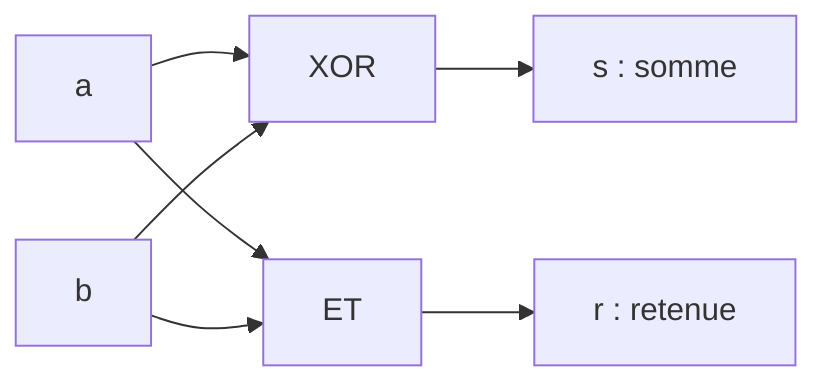
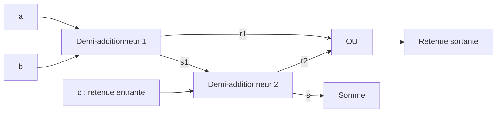
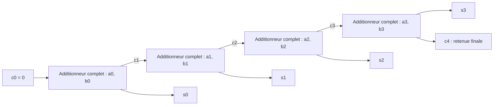
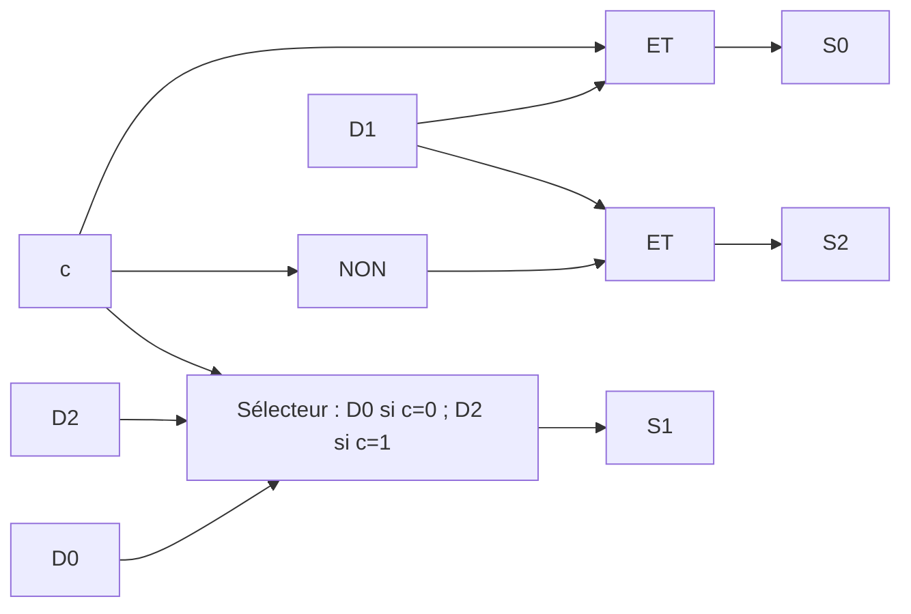

# Niveau 0 — Les portes logiques

## L’algèbre booléenne

L’algèbre booléenne manipule deux valeurs, **0 et 1**, interprétées ici comme **faux et vrai**. Elle porte le nom de **George Boole (1815–1864)**.

Les opérateurs logiques sont décrits par des **tables de vérité**. Leurs règles diffèrent de l’arithmétique usuelle : par exemple, le OU logique donne `1 + 1 = 1`.

### Lois booléennes

**De Morgan :**

$$
\neg(A \lor B) = \neg A \land \neg B
$$

$$
\neg(A \land B) = \neg A \lor \neg B
$$

**Distributivité :**

$$
A \land (B \lor C) = (A \land B) \lor (A \land C)
$$

$$
A \lor (B \land C) = (A \lor B) \land (A \lor C)
$$

### D’une expression à une table de vérité

On note ET par $\cdot$, OU par $+$ et NON par une barre.
Attention : le OU est une opération logique ; $1+1=1$.

Prenons l'expression :

$$
S = A \cdot (B + \overline{A})
$$

Avec deux variables, on énumère les $2^2=4$ combinaisons.
On calcule chaque étape dans une colonne :

| $A$ | $B$ | $\overline{A}$ | $B+\overline{A}$ | $S$ |
| --- | --- | --- | --- | --- |
| 0 | 0 | 1 | 1 | 0 |
| 0 | 1 | 1 | 1 | 0 |
| 1 | 0 | 0 | 0 | 0 |
| 1 | 1 | 0 | 1 | 1 |

### D’une table de vérité à une expression

Considérons cette autre table :

| $A$ | $B$ | $S$ |
| --- | --- | --- |
| 0 | 0 | 0 |
| 0 | 1 | 1 |
| 1 | 0 | 1 |
| 1 | 1 | 1 |

#### Méthode systématique : somme de produits

1. Sélectionner les lignes où la sortie vaut 1.
2. Pour chaque ligne, relier toutes les variables par ET. Une variable valant 0 est écrite avec une barre ; une variable valant 1 est écrite sans barre.
3. Relier les termes obtenus par OU.

Chaque terme vaut 1 uniquement pour sa ligne :

- La ligne $(0,1)$ donne $\overline{A}\cdot B$.
- La ligne $(1,0)$ donne $A\cdot\overline{B}$.
- La ligne $(1,1)$ donne $A\cdot B$.

On obtient :

$$
S=\overline{A}\cdot B+A\cdot\overline{B}+A\cdot B
$$

#### Simplification de l’expression

On factorise les deux derniers termes par $A$ :

$$
S=\overline{A}\cdot B+A\cdot(\overline{B}+B)
$$

Comme $\overline{B}+B=1$ et $A\cdot1=A$ :

$$
S=\overline{A}\cdot B+A
$$

On réordonne et on applique la distributivité :

$$
S=A+\overline{A}\cdot B =(A+\overline{A})\cdot(A+B)
$$

Comme $A+\overline{A}=1$ :

$$
S=1\cdot(A+B)=A+B
$$

L'expression simplifiée est donc $S=A+B$.
La sortie vaut 1 dès qu'au moins une des entrées vaut 1.

## Les circuits logiques

> [!NOTE]
> **Transistor**
>
> Composant électronique pouvant fonctionner comme un **interrupteur commandé électriquement**.

**Transistors → portes logiques → circuits de calcul**

| Symbole | Opération | La sortie vaut 1 si… |
| :---: | :--- | :--- |
| ∧ | **ET** | Les deux entrées valent 1 |
| ∨ | **OU** | Au moins une entrée vaut 1 |
| ¬ | **NON** | L’entrée vaut 0 |
| ⊕ | **XOR** | Les deux entrées sont différentes |

## Circuits pour réaliser l’arithmétique binaire

### Demi-additionneur — somme de deux bits

Entrées : $a$, $b$.
Sorties : somme $s$, retenue $r$.

$$
\boxed{s=a\oplus b} \qquad \boxed{r=a\land b}
$$

| $a$ | $b$ | $r$ | $s$ |
| --- | --- | --- | --- |
| 0 | 0 | 0 | 0 |
| 0 | 1 | 0 | 1 |
| 1 | 0 | 0 | 1 |
| 1 | 1 | 1 | 0 |

Exemple : $1+1=10$ en binaire.
La retenue est le bit de poids fort.



*Schéma fonctionnel du demi-additionneur.*

### Additionneur complet — somme de trois bits

Entrées : $a$, $b$, retenue entrante $c$.

$$
s=a\oplus b\oplus c
$$


$$
r=(a\land b)\lor\bigl((a\oplus b)\land c\bigr)
$$

Construction : deux demi-additionneurs et une porte OU.



*Schéma fonctionnel : deux demi-additionneurs et une porte OU.*

### Addition de deux nombres sur quatre bits

Un additionneur par colonne.
Calcul de droite à gauche :
chaque retenue passe à la colonne suivante.

```text
+ 0111   (7)
+ 0011   (3)
-------
= 1010  (10)
```

Retenue initiale : 0.
La retenue finale peut donner un cinquième bit.



*Propagation de la retenue du bit de poids faible vers le bit de poids fort.*

### Circuit de décalage logique

Entrée : $D_2D_1D_0$.
Sortie : $S_2S_1S_0$.
Les places libérées sont remplies par 0.

| Commande | Sens | Sortie |
| --- | --- | --- |
| $c=0$ | Gauche | $D_1\,D_0\,0$ |
| $c=1$ | Droite | $0\,D_2\,D_1$ |

Exemple :

```text
		 110
		/   \
gauche /     \ droite
	  100   011
```

$$
S_0=c\land D_1 \qquad S_2=\neg c\land D_1
$$


$$
S_1=(\neg c\land D_0)\lor(c\land D_2)
$$



*Schéma fonctionnel correspondant aux équations ci-dessus. Le bloc central est un multiplexeur 2 vers 1.*


## Référence

Syllabus INFO-F102 2026–2027, pages 107–123 (numérotation imprimée).

---

[← Précédent](4.3%20-%20Les%20p%C3%A9riph%C3%A9riques.md)
