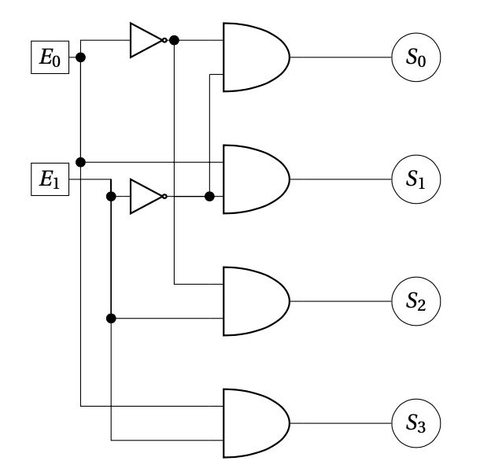

# Décodeur

## Rôle

Un **décodeur** reçoit une valeur binaire et active la sortie correspondant à cette valeur.

> [!IMPORTANT]
> Pour le décodeur vu au cours, **une seule sortie vaut 1** ; toutes les autres valent 0.

## Entrées et sorties

| Élément | Description |
| :--- | :--- |
| **Entrées** | Un nombre binaire non signé sur **n bits** |
| **Sorties** | **2ⁿ sorties**, une par valeur possible |

Si la valeur d’entrée est **k**, la sortie **Sₖ** vaut 1.

## Exemple : décodeur 2 vers 4

- **Entrées** : E₁, E₀ ; E₁ est le bit de poids fort.
- **Sorties** : S₀, S₁, S₂, S₃.

### Table de vérité

|               E₁               |               E₀               |               S₃               |               S₂               |               S₁               |               S₀               |
| :----------------------------: | :----------------------------: | :----------------------------: | :----------------------------: | :----------------------------: | :----------------------------: |
|               0                |               0                |               0                |               0                |               0                | 1 |
|               0                | 1 |               0                |               0                | 1 |               0                |
| 1 |               0                |               0                | 1 |               0                |               0                |
| 1 | 1 | 1 |               0                |               0                |               0                |

Par exemple, **E₁E₀ = 10₂ = 2₁₀** active uniquement **S₂**.

### Équations des sorties

Chaque sortie correspond à une combinaison précise des entrées :

$$
S_0 = \neg E_1 \land \neg E_0
$$

$$
S_1 = \neg E_1 \land E_0
$$

$$
S_2 = E_1 \land \neg E_0
$$

$$
S_3 = E_1 \land E_0
$$

## Circuit

*Figure 9 — Un décodeur 4 bits.*

## Lien
[Portes logiques](5%20-%20Portes%20logiques.md)

[Suite → Multiplexeur](5.2%20-%20Multiplexeur.md)
