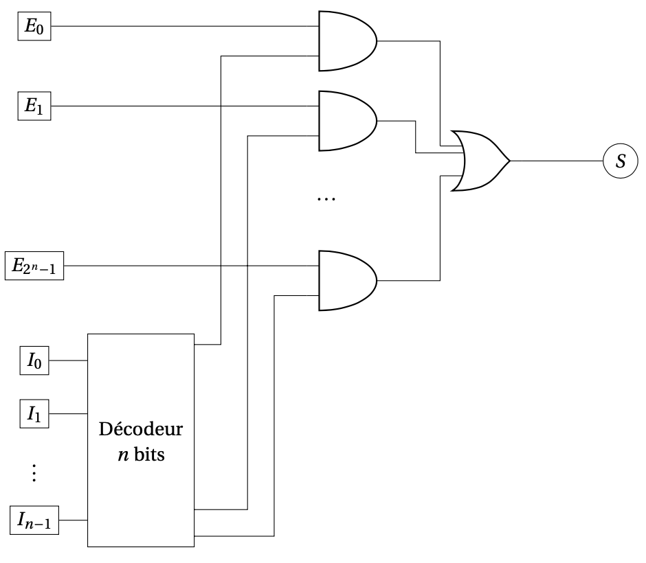

# Multiplexeur

## Rôle

Un **multiplexeur** sélectionne une entrée parmi plusieurs et copie sa valeur sur **une seule sortie**.

> [!NOTE]
> **Un aiguillage**
>
> Les bits de commande indiquent quelle entrée doit être transmise.

## Entrées et sortie

Pour l’exemple **4 vers 1** :

| Élément | Rôle |
| :--- | :--- |
| **D₀, D₁, D₂, D₃** | Quatre entrées de données de 1 bit |
| **C₁, C₀** | Deux bits de commande |
| **S** | Sortie de 1 bit |

## Fonctionnement

| C₁ | C₀ | Sortie S |
| :---: | :---: | :---: |
| 0 | 0 | D₀ |
| 0 | 1 | D₁ |
| 1 | 0 | D₂ |
| 1 | 1 | D₃ |

Par exemple, **C₁C₀ = 10₂** sélectionne **D₂**.

### Construction avec un décodeur

1. Le décodeur transforme les bits de commande en quatre signaux, dont **un seul vaut 1**.
2. Une porte **ET** laisse passer la donnée sélectionnée : `x ET 1 = x`. Les autres sont bloquées : `x ET 0 = 0`.
3. Une porte **OU** rassemble les résultats : `x OU 0 = x`.

## Équation de la sortie

$$
S = (\neg C_1 \land \neg C_0 \land D_0) \lor (\neg C_1 \land C_0 \land D_1) \lor (C_1 \land \neg C_0 \land D_2) \lor (C_1 \land C_0 \land D_3)
$$

## Circuit

*Figure 10 — Le multiplexeur $2n$ bits ou « $2n$ vers $1$ »*

---

[← Décodeur](5.1%20-%20D%C3%A9codeur.md) · [Suite → ALU](5.3%20-%20ALU.md)
