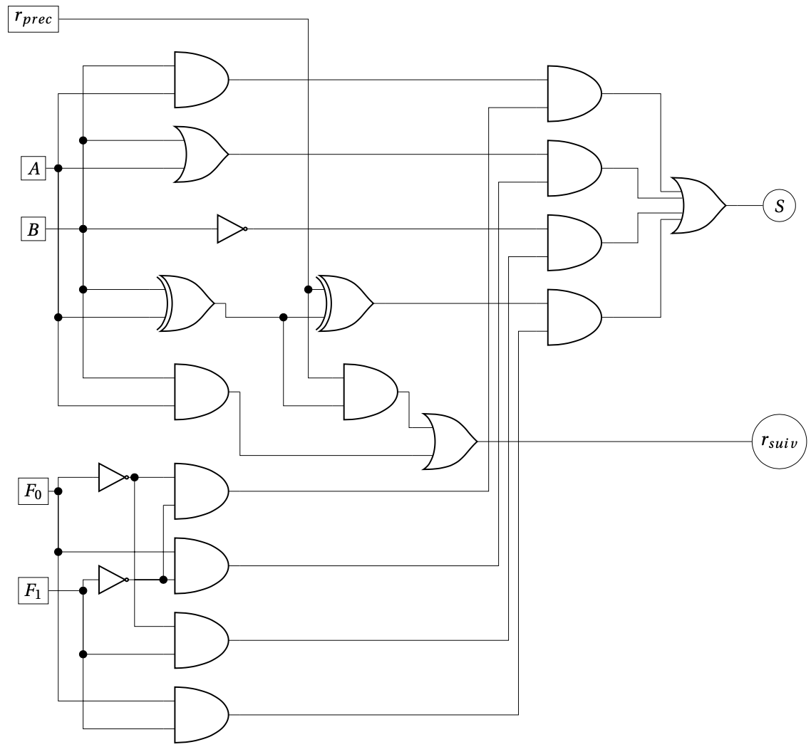
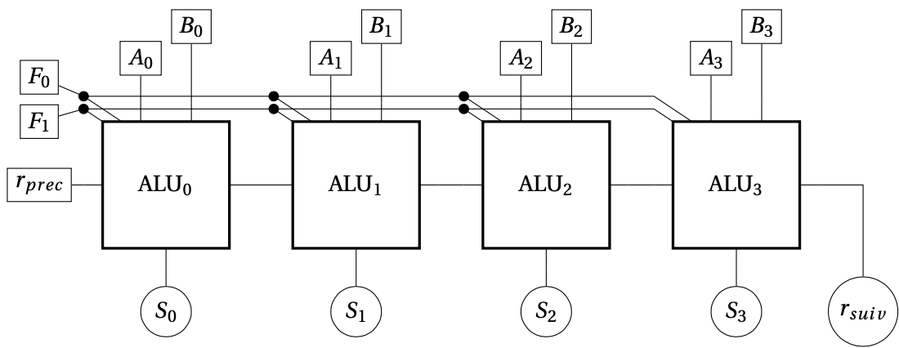

# ALU — Unité arithmétique et logique

## Rôle

Une **ALU** réalise une opération arithmétique ou logique choisie par des **bits de commande**.

## ALU 1 bit

### Entrées et sorties

| Élément | Rôle |
| :--- | :--- |
| **A, B** | Deux données de 1 bit |
| **F₁, F₀** | Choix de l’opération |
| **r précédent** | Retenue entrante pour l’addition |
| **S** | Résultat de 1 bit |
| **r suivant** | Retenue sortante pour l’addition |

### Opérations de l’exemple du cours

| F₁ | F₀ | Résultat S |
| :---: | :---: | :--- |
| 0 | 0 | A ET B |
| 0 | 1 | A OU B |
| 1 | 0 | NON B |
| 1 | 1 | Somme de A, B et de la retenue entrante — bit de somme |

### Fonctionnement

Les circuits calculent les résultats possibles. Un **multiplexeur**, piloté par F₁ et F₀, transmet le résultat de l’opération choisie.

Pour l’addition :

$$
S = A \oplus B \oplus r_{\mathrm{précédent}}
$$

La retenue est fournie par l’additionneur complet.

### Circuit — ALU 1 bit

*Figure 11 — Une ALU 1 bit avec 4 opérations.*

## ALU 4 bits

On assemble **quatre ALU de 1 bit** : une pour chaque paire de bits Aᵢ, Bᵢ.

- **Entrées de données** : A₃A₂A₁A₀ et B₃B₂B₁B₀.
- **Commandes** : F₁ et F₀, communes aux quatre ALU.
- **Résultat** : S₃S₂S₁S₀, accompagné de la retenue finale pour l’addition.
- Pour l’addition, chaque retenue sortante est transmise à l’ALU du bit suivant, du poids faible vers le poids fort.

> [!IMPORTANT]
> Pour additionner deux nombres de 4 bits, la retenue initiale vaut **0**. La retenue finale peut former un **cinquième bit** du résultat non signé.

### Circuit — ALU 4 bits

*Figure 12 —  Une ALU 4 bits réalisée sur base de 4 ALUs 1 bit. Notez que le bit de poids faible est à gauche et non pas à droite.*

---

[← Multiplexeur](5.2%20-%20Multiplexeur.md) · [Suite → Circuits de mémoire](5.4%20-%20Circuits%20de%20m%C3%A9moire.md)
