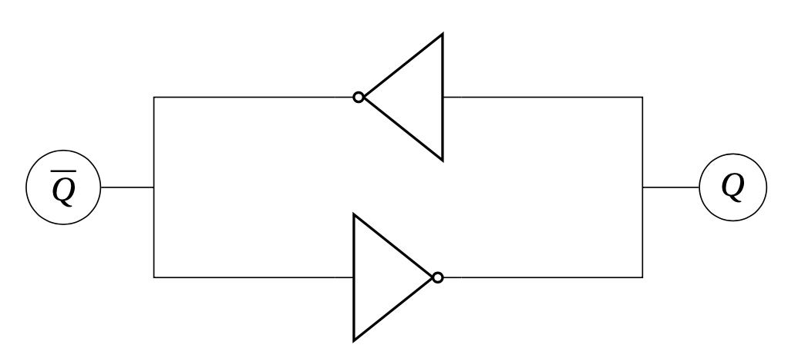
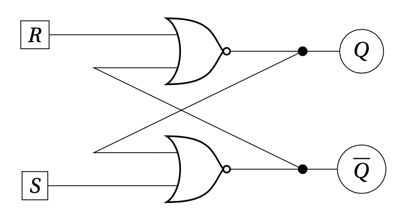
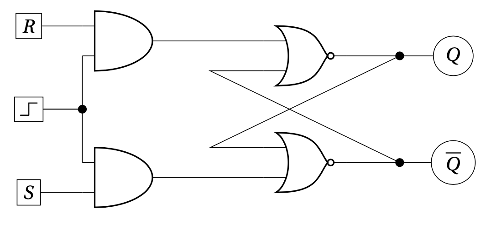
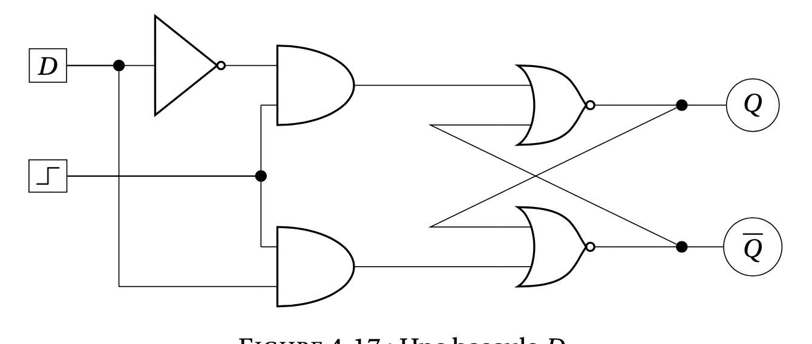
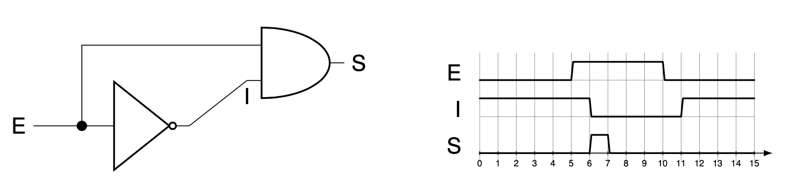

# Circuits de mémoire

## Calculer ou mémoriser

| Circuit | De quoi dépend sa sortie ? |
| :--- | :--- |
| **Circuit de calcul** | Des entrées présentes à un instant donné |
| **Circuit de mémoire** | Des entrées et de l’état conservé auparavant |

Exemple : après `écrire(5, 2)`, `lire(5)` renvoie 2. Après `écrire(5, 3)`, le même appel `lire(5)` renvoie 3.

## Mémoire élémentaire — 1 bit

Deux inverseurs connectés en boucle peuvent conserver **deux états stables** :

|  Q  | Q̅  | Bit conservé |
| :-: | :-: | :----------: |
|  0  |  1  |      0       |
|  1  |  0  |      1       |

On a **Q̅ = NON Q** dans ces deux états.

### Circuit

*Figure 17 — Une boucle de portes non qui permet de stocker une valeur binaire.*

## Bascule SR

- **S** : *Set*, pour écrire 1.
- **R** : *Reset*, pour écrire 0.
- **Q** : bit mémorisé ; Q̅ est son complément dans les états autorisés.

### Table de fonctionnement — montage à portes NOR

| S | R | Effet sur Q |
| :---: | :---: | :--- |
| 0 | 0 | Conserver la valeur précédente |
| 0 | 1 | Écrire 0 |
| 1 | 0 | Écrire 1 |
| 1 | 1 | **Combinaison interdite** |

### Équations du montage

$$
Q = \neg(\overline{Q} \lor R)
$$

$$
\overline{Q} = \neg(Q \lor S)
$$

> [!IMPORTANT]
> Quand **S = R = 0**, le circuit conserve son état. C’est ce qui lui permet de mémoriser un bit.

### Circuit

*Figure 18 — Une bascule.*

## Ajout d’une horloge

Une **horloge** est un signal qui oscille régulièrement entre 0 et 1. Elle permet de synchroniser les circuits et de déterminer quand une écriture est autorisée.

Dans le montage vu au cours, l’écriture est autorisée lorsque **l’horloge vaut 1**.

### Circuit

*Figure 19 — Une bascule avec ajout d'un horloge.*

## Bascule D

La bascule D utilise une entrée **D**, la donnée à écrire, et une commande d’écriture — ici l’horloge.

| Horloge | D | Comportement |
| :---: | :---: | :--- |
| 0 | Indifférent | Q conserve sa valeur |
| 1 | 0 | Q prend la valeur 0 |
| 1 | 1 | Q prend la valeur 1 |

Quand l’écriture est autorisée, on commande la bascule SR avec **S = D** et **R = NON D**. Sinon, **S = R = 0**.

### Circuit

*Figure 19 — Une bascule D.*

## Flip-flop

Avec la bascule D précédente, la donnée peut être enregistrée pendant **tout l’intervalle où l’horloge vaut 1**.

Le montage étudié ensuite vise une écriture au **front montant**, lorsque l’horloge passe de **0 à 1**.

### Générateur de pulsation

Le cours utilise le **temps de propagation des portes** pour produire une courte impulsion lors du front montant : le signal et son inverse retardé valent brièvement 1 en même temps à l’entrée d’une porte ET.

> [!NOTE]
> Le délai est essentiel : avec des portes idéales sans délai, `E ET NON E` vaudrait toujours 0 et ne produirait pas d’impulsion.

### Circuits

*Figure 19 — Un générateur de pulsation : le délai de propagation dans la porte « et » va générer une sortie à vrai pendant un court instant (on suppose que le délai des portes est d’une unité de temps).*

---

[← ALU](5.3%20-%20ALU.md) · [Portes logiques](5%20-%20Portes%20logiques.md)
